# AulaViva

Plataforma SaaS multi-tenant para colegios de la Región Metropolitana: evaluaciones auto-corregidas con feedback, tutor IA sobre los apuntes de cada curso (RAG) y panel de seguimiento para apoderados. Proyecto del Taller de Ingeniería de Software.

## Contenido

1. [Descripción y alcance del MVP](#descripción-y-alcance-del-mvp)
2. [Estado del proyecto](#estado-del-proyecto)
3. [Equipo y forma de trabajo](#equipo-y-forma-de-trabajo)
4. [Ejecutar en local](#ejecutar-en-local)
5. [API](#api)
6. [Arquitectura y documentación](#arquitectura-y-documentación)
7. [Estructura del repositorio](#estructura-del-repositorio)
8. [Despliegue en Kubernetes (S07)](#despliegue-en-kubernetes-s07)
9. [CI/CD y GitOps (S08)](#cicd-y-gitops-s08)
10. [Seguridad (DevSecOps · S09–S10)](#seguridad-devsecops--s09s10)
11. [Índice de evidencia para el panel S18](#índice-de-evidencia-para-el-panel-s18).

## Descripción y alcance del MVP

AulaViva busca mejorar la experiencia de aprendizaje de estudiantes y docentes con gestión académica, evaluaciones automáticas y apoyo de inteligencia artificial, respetando el currículum vigente del MINEDUC.

| Capacidad del MVP | Estado |
|---|---|
| Multi-tenancy real: 1 colegio = 1 tenant aislado lógicamente | ✅ Implementado (S18 · Día 1) |
| Gestión de cursos, docentes y estudiantes con RBAC | ✅ Roles y permisos implementados; gestión vía datos de demo |
| Evaluaciones auto-corregidas con feedback | ✅ Implementado (S18 · Día 1) |
| Tutor IA con RAG sobre los apuntes de cada curso | ⏳ Diseño cerrado: Groq + BM25 ([ADR 0009](docs/adr/0009-tutor-ia-proveedor-llm.md)); implementación en Día 4 |
| Panel del apoderado con seguimiento de avance | ✅ API y UI implementadas (S18 · Día 2) |

## Estado del proyecto

_Actualizado: 18-11-2026._

El backend ya ejecuta el flujo crítico de la demo (crear evaluación, rendir con nota y feedback, ver progreso) con aislamiento entre colegios y control de acceso por rol. La infraestructura (contenedores, Kubernetes, GitOps) y el pipeline DevSecOps están operativos desde S07–S10. El trabajo restante hacia la defensa final (S18) sigue el plan de 7 días.

| Área | Estado | Evidencia |
|---|---|---|
| Producto: charter, impact map, backlog, escenarios | ✅ | [CHARTER](CHARTER.md) · [backlog](docs/backlog.md) · [impact map](docs/impact-map.md) · [escenarios](docs/scenarios/) |
| Arquitectura: C4 L1–L2, ADRs 0001–0006 (S01–S10) | ✅ | [C4](docs/c4/) · [ADRs](docs/adr/) |
| Datos y API: DER, bounded contexts, eventos, OpenAPI 3.1 | ✅ | [docs/data](docs/data/) · [openapi.yaml](api/openapi.yaml) |
| Contenedores y Kubernetes (S07) | ✅ | [Despliegue](#despliegue-en-kubernetes-s07) |
| CI/CD y GitOps con Argo CD (S08) | ✅ | [CI/CD](#cicd-y-gitops-s08) |
| DevSecOps: SAST, SCA, SBOM, secretos, IaC, firma, Kyverno, DAST, Falco (S09–S10) | ✅ | [Seguridad](#seguridad-devsecops--s09s10) |
| **Backend funcional (S18 · Día 1):** multi-tenant, RBAC, evaluaciones, progreso, outbox, datos de demo | ✅ | PR #60 · 25 tests · cobertura ≥ 70 % |
| Demo del Día 1 por script (PowerShell y bash) | ✅ | [guion](docs/demo/guion-demo.md) · [manual de pruebas](docs/qa/AulaViva_S18_Sesion1_Resumen_y_Manual_de_Pruebas.pdf) · [captura](docs/qa/evidence/s18/01-demo-dia1.png) |
| UI web, C4 L3, ADRs 0007–0009, corpus y golden set (S18 · Día 2) | ✅ | [UI](backend/src/main/resources/static/) · [C4](docs/c4/) · [ADRs](docs/adr/) · [corpus](backend/src/main/resources/corpus/) · [golden set](rag/eval/golden-set.jsonl) · [model card](docs/ai/model-card.md) |
| Tests de contrato y seguridad ampliados, staging en Codespaces | ⏳ Día 3 | — |
| Tutor IA con guardrails, evaluación y model card | ⏳ Día 4 | — |
| SLOs, DR, game day y post-mortem | ⏳ Día 5 | — |
| FinOps, deck y preparación del Q&A | ⏳ Día 6 | — |
| Release v1.0.0 y guion de práctica | ⏳ Día 7 | — |

## Equipo y forma de trabajo

| Integrante | Rol |
|---|---|
| Branco Merino | PO |
| Matías Díaz | Tech Lead |
| Valentina León | DevSecOps |
| Gerardo González | AI/Data |
| Alexander Ruiz-Tagle | QA |

- **Planificación:** GitHub Issues y tablero Kanban (Backlog, To Do, In Progress, Review, Blocked, Done).
- **Ramas:** cada tarea en su rama desde `desarrollo`, con PR hacia `desarrollo` y checks en verde; `main` está protegida.
- **Comunicación:** Discord. Las decisiones se registran en Issues, PRs o documentos del repositorio (ADRs).
- **Uso de IA:** registrado en [docs/uso-ia.md](docs/uso-ia.md).

## Ejecutar en local

Backend con H2 en memoria: no requiere Docker (apto para un PC de 8 GB). Requisitos: Java 21 y Maven 3.9.

```bash
cd backend
mvn -B verify                                   # tests + cobertura (gate 70 %)
export DEMO_PASSWORD='<tu-clave>'               # PowerShell: $env:DEMO_PASSWORD = '<tu-clave>'
java -Xmx512m -jar target/app.jar --spring.profiles.active=h2,demo
```

Con la app corriendo, en otra terminal:

- PowerShell: `.\scripts\demo-dia1.ps1 -Password '<tu-clave>'`
- Git Bash / Codespaces: `DEMO_PASSWORD='<tu-clave>' ./scripts/demo-dia1.sh`
  
Manual completo con todas las pruebas paso a paso (PowerShell y bash): [docs/qa/AulaViva_S18_Sesion1_Resumen_y_Manual_de_Pruebas.pdf](docs/qa/AulaViva_S18_Sesion1_Resumen_y_Manual_de_Pruebas.pdf)

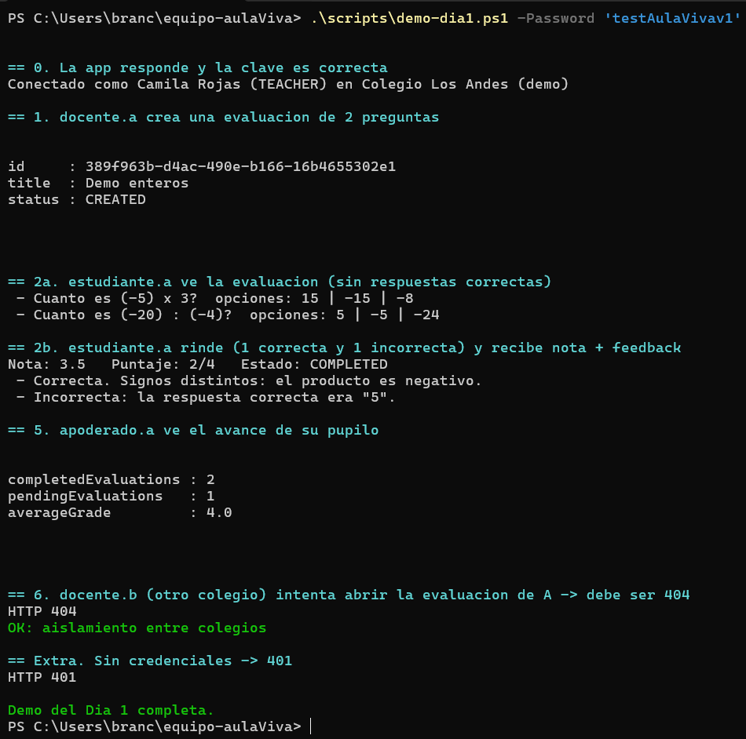


| Perfil | Uso |
|---|---|
| `h2` (por defecto) | Base en memoria para el PC local y los tests |
| `pg` | PostgreSQL (`DB_URL`, `DB_USER`, `DB_PASSWORD`) para compose/staging |
| `demo` | Carga 2 colegios, 6 usuarios y 3 evaluaciones; la contraseña llega por `DEMO_PASSWORD` |

Usuarios de demo: `docente.a`, `estudiante.a`, `apoderado.a` (Colegio A) y `docente.b`, `estudiante.b`, `coordinador.b` (Colegio B). Todos los nombres son ficticios.

## API

Contrato completo en [`api/openapi.yaml`](api/openapi.yaml). Autenticación HTTP Basic sobre HTTPS en el MVP; los POST exigen el header `Idempotency-Key`. Los errores responden en formato ProblemDetails.

| Endpoint | Rol | Descripción |
|---|---|---|
| `POST /v1/evaluations` | TEACHER del curso | Crea una evaluación |
| `GET /v1/evaluations/{id}` | TEACHER del curso, STUDENT inscrito, COORDINATOR | Evaluación sin respuestas correctas |
| `POST /v1/evaluations/{id}/submissions` | STUDENT inscrito | Corrige y devuelve nota (1,0–7,0, exigencia 60 %) y feedback por pregunta |
| `GET /v1/students/{id}/progress` | GUARDIAN, TEACHER, COORDINATOR, el propio STUDENT | Avance del estudiante |
| `GET /v1/me` · `GET /v1/me/evaluations` | Cualquiera autenticado | Contexto del usuario y sus evaluaciones (para la UI) |
| `POST /v1/tutor/questions` | STUDENT | Stub (501) hasta el Día 4 |
| `GET /api/v1/status` · `GET /actuator/health` | Público | Estado del servicio |

**Aislamiento multi-tenant:** el colegio se toma siempre del usuario autenticado, nunca del request; un recurso de otro colegio responde 404. Lo verifica `SeguridadTest`.

## Arquitectura y documentación

- **Estilo:** monolito modular por bounded context, preparado para evolucionar a microservicios ([ADR 0002](docs/adr/0002-estilo-arquitectonico.md)).
- **Stack:** Spring Boot 3.5 · Java 21 · JPA + Flyway · PostgreSQL (H2 en local) · Spring Security.
- **Cloud objetivo:** AWS con servicios gestionados ([ADR 0003](docs/adr/0003-cloud-style.md), [managed services](docs/arch/managed-services.md)).

| Documento | Ubicación |
|---|---|
| Charter del equipo | [CHARTER.md](CHARTER.md) |
| Impact map y backlog (INVEST, MoSCoW) | [impact-map.md](docs/impact-map.md) · [backlog.md](docs/backlog.md) |
| Escenarios Gherkin | [docs/scenarios/](docs/scenarios/) |
| Diagramas C4 (L1, L2, L3) | [docs/c4/](docs/c4/) |
| ADRs | [docs/adr/](docs/adr/) |
| Atributos de calidad y tecnologías | [docs/arch/](docs/arch/) |
| DER, bounded contexts y catálogo de eventos | [docs/data/](docs/data/) |
| Contrato OpenAPI y política de versionado | [api/openapi.yaml](api/openapi.yaml) · [docs/api/](docs/api/) |
| Checklist 12-Factor | [docs/12-factor-checklist.md](docs/12-factor-checklist.md) |
| Modelo de amenazas | [docs/threat-model.md](docs/threat-model.md) |
| Validaciones QA y evidencias | [docs/qa/](docs/qa/) |
| Guion de la demo | [docs/demo/guion-demo.md](docs/demo/guion-demo.md) |
| Tutor IA: proveedor, model card y golden set | [configuración](docs/tutor-ia/configuracion-proveedor.md) · [model card](docs/ai/model-card.md) · [golden set](rag/eval/) |

| ADR | Decisión |
|---|---|
| [0001](docs/adr/0001-eleccion-iniciativa.md) | Elección de la iniciativa AulaViva |
| [0002](docs/adr/0002-estilo-arquitectonico.md) | Monolito modular → microservicios |
| [0003](docs/adr/0003-cloud-style.md) | AWS como proveedor cloud |
| [0004](docs/adr/0004-datos-y-eventos.md) | Persistencia por bounded context y patrón Outbox |
| [0004](docs/adr/0004-plataforma-k8s.md) | Plataforma Kubernetes e infraestructura como código |
| [0005](docs/adr/0005-gitops-strategy.md) | GitOps con Argo CD y Kustomize |
| [0006](docs/adr/0006-supply-chain.md) | Firma de imágenes y SLSA |
| [0007](docs/adr/0007-estrategia-multi-tenant.md) | Multi-tenant con `tenant_id` y 404 entre colegios |
| [0008](docs/adr/0008-identidad-y-rbac.md) | HTTP Basic + RBAC en el MVP; OIDC en producción |
| [0009](docs/adr/0009-tutor-ia-proveedor-llm.md) | Tutor IA con Groq, RAG léxico BM25, guardrails y fallback |

## Estructura del repositorio

```text
backend/            Servicio principal (Spring Boot): código, tests, Dockerfile
api/                Contrato OpenAPI y ejemplos
rag/eval/           Golden set del Tutor IA (los apuntes viven en backend/src/main/resources/corpus/)
docs/               Producto, arquitectura (C4, ADRs), datos, QA y evidencias
k8s/                Manifiestos Kubernetes (Deployment, Service, Ingress, HPA) y políticas Kyverno
terraform/          Infraestructura como código (namespace y secrets)
falco/              Reglas propias y configuración de Falco/Falcosidekick
scripts/            Scripts de demo (PowerShell y bash)
.github/workflows/  CI, seguridad, validación Docker y Terraform
.semgrep/ .zap/     Reglas propias de SAST y configuración de DAST
```

## Despliegue en Kubernetes (S07)

Servicio principal: `backend/` (Spring Boot 3.5, Java 21).

- **Imagen:** Dockerfile multi-stage (Maven + Temurin 21 para compilar, `distroless/java21-debian13:nonroot` como imagen final), publicada en GHCR y referenciada por digest en `k8s/deployment.yaml`.
- **Manifiestos:** `k8s/` (Deployment, Service, Ingress, ConfigMap y HPA), aplicados con `kubectl apply -k k8s/`.
- **Infraestructura como código:** `terraform/` crea el namespace `equipo-aulaviva` y un secret placeholder. El provider está en `version.tf` y el backend remoto en `backend.tf`.

### Estado del despliegue

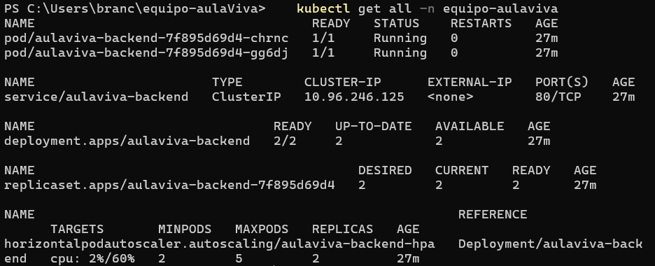

### Prueba del HPA

Se realizó una prueba de carga sintética para comprobar el escalado automático del backend. El HPA aumenta las réplicas cuando se supera el umbral de CPU configurado y las reduce cuando termina la carga.

**1. Escalado: la CPU supera el 60% y el HPA sube las réplicas**

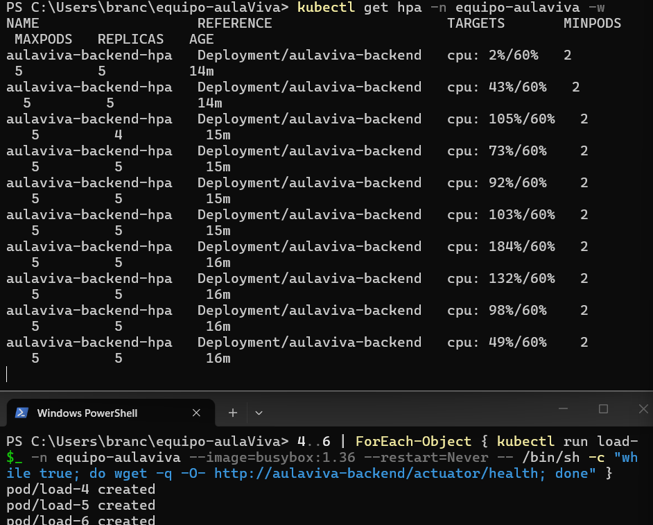

**2. Pods y consumo con las réplicas escaladas**

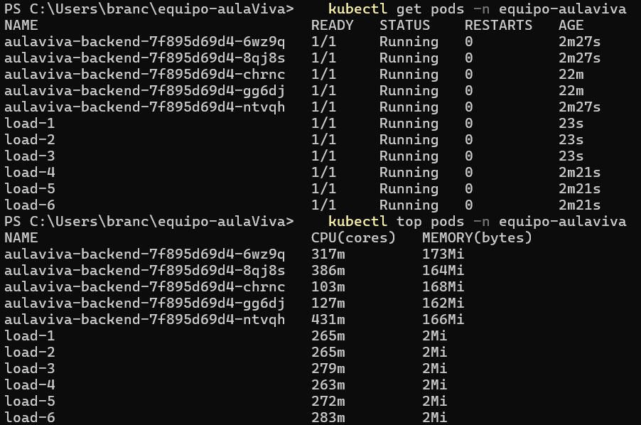

**3. Reducción: al detener la carga vuelve a 2 réplicas**

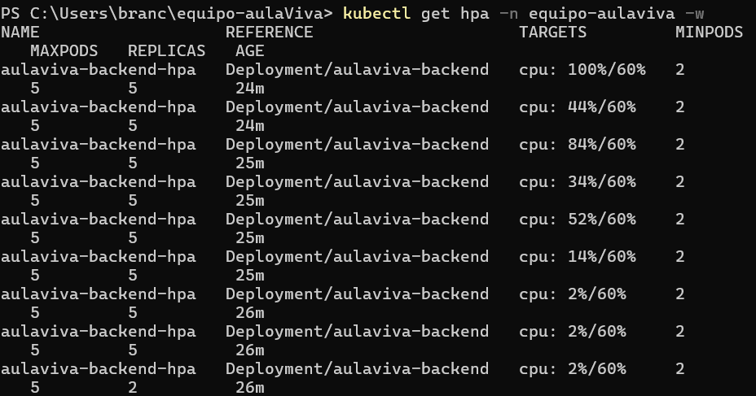

## CI/CD y GitOps (S08)

Durante S08 se incorporó la validación automatizada del backend y la gestión de los manifiestos Kubernetes mediante un repositorio GitOps independiente.

- **CI:** validaciones automatizadas mediante GitHub Actions.
- **Kustomize:** organización de los manifiestos en una configuración base y overlays para desarrollo y producción.
- **Argo CD:** sincronización automática en desarrollo y sincronización manual en producción.
- **Repositorio GitOps:** [equipo-aulaviva-gitops](https://github.com/merinobranco10/equipo-aulaviva-gitops).

### Evidencias S08

**1. Aplicaciones sincronizadas y saludables en Argo CD**

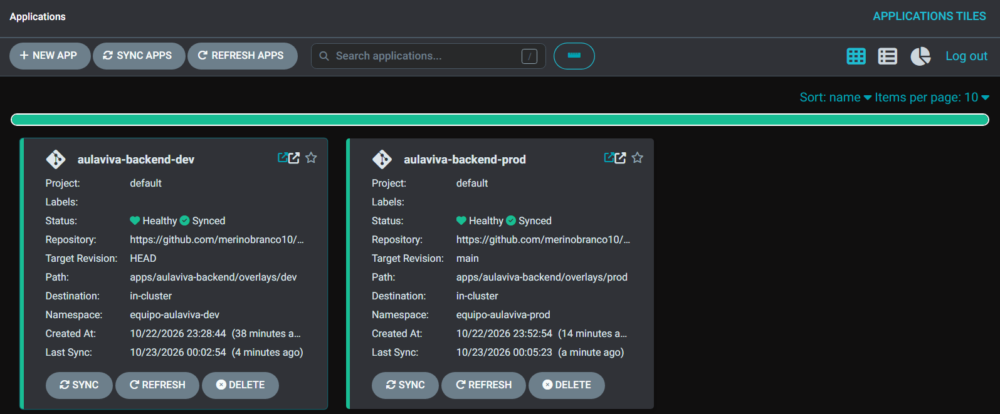

**2. Validación de manifiestos con Kustomize**

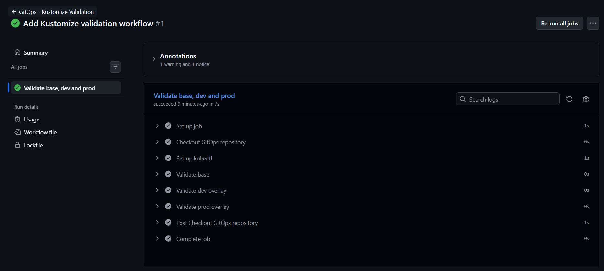

**3. Pipeline de CI exitoso**

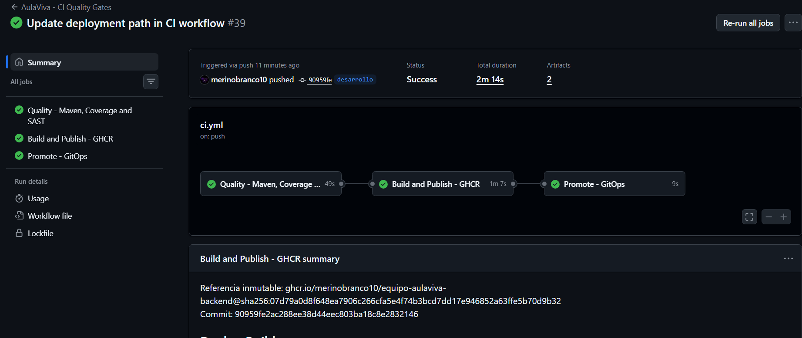

## Seguridad (DevSecOps · S09–S10)

Resumen de controles. Todos corren en `.github/workflows/security.yml` en cada PR hacia `main`/`desarrollo` y en cada push a `desarrollo`.

| Control | Herramienta | Sesión | Detalle |
|---|---|---|---|
| SAST | Semgrep (`p/java`, `p/owasp-top-ten`, reglas propias) | S09 | [Pipeline de seguridad](#pipeline-de-seguridad-s09--devsecops-i) |
| SCA + SBOM | Trivy + CycloneDX | S09 | [SBOM](#generación-y-publicación-del-sbom-cyclonedx) |
| Secretos | gitleaks (historial completo) | S09 | [Gitleaks](#detección-de-secretos-con-gitleaks) |
| IaC | Checkov (Terraform) | S10 | `.github/workflows/security.yml` |
| Imagen | Trivy (container scan) | S10 | `.github/workflows/security.yml` |
| Firma y procedencia | Cosign + attestation SLSA | S10 | [ADR 0006](docs/adr/0006-supply-chain.md) |
| Admisión en el clúster | Kyverno (`require-image-signature`) | S10 | [DAST y admisión](docs/qa/s10-dast-y-admision.md) · `k8s/policies/` |
| DAST | OWASP ZAP baseline | S10 | [DAST y admisión](docs/qa/s10-dast-y-admision.md) · `.zap/rules.tsv` |
| Seguridad en ejecución | Falco + Falcosidekick | S10 | [Reglas y alertas](docs/qa/s10-falco-alertas.md) · `falco/` |
| Modelo de amenazas | STRIDE | S09 | [threat-model.md](docs/threat-model.md) |

### Pipeline de seguridad (S09 · DevSecOps I)

La seguridad se verifica en cada Pull Request hacia `main` y `desarrollo` (y en cada push a `desarrollo`) mediante el workflow **AulaViva - Security Analysis**: `.github/workflows/security.yml`. Los tres jobs corren en paralelo y los tres son **gates bloqueantes**.

| Job | Herramienta | Qué revisa | Cuándo bloquea |
|---|---|---|---|
| `sast` | Semgrep (`p/java`, `p/owasp-top-ten` y reglas propias de `.semgrep/`) | Código Java/Spring Boot del backend | Cualquier hallazgo (`--error`) o fallo de la herramienta |
| `sca` | Trivy (filesystem) + CycloneDX | Dependencias directas y transitivas (`backend/pom.xml`) | Vulnerabilidades HIGH/CRITICAL con parche disponible (`ignore-unfixed`) |
| `secrets` | gitleaks con `fetch-depth: 0` | Archivos actuales e historial completo de Git | Cualquier secreto detectado |

#### Artefactos de cada ejecución

| Artefacto | Job | Contenido |
|---|---|---|
| `semgrep-sast-results` | `sast` | Resultados SARIF de Semgrep (14 días) |
| `aulaviva-sbom` | `sca` | `sbom.json` en CycloneDX (90 días) |
| `gitleaks-results.sarif` | `secrets` | Reporte SARIF de gitleaks |

#### Reglas propias de Semgrep (`.semgrep/java-security.yml`)

| Regla | Detecta | Referencia |
|---|---|---|
| `aulaviva.spring-cors-wildcard` | `@CrossOrigin` con `origins = "*"` | CWE-942 · OWASP A05:2021 |
| `aulaviva.java-weak-message-digest` | `MessageDigest.getInstance("MD5" \| "SHA-1")` | CWE-328 · OWASP A02:2021 |

Las reglas viven en el repositorio y se versionan junto al código. Para agregar una, crea o edita un archivo en `.semgrep/`; el workflow lo toma automáticamente.

#### Cómo re-triar un hallazgo

1. **Abrir el resultado:** en **Actions**, entrar al job que falló. Para SAST, descargar `semgrep-sast-results`; para SCA, revisar la tabla de Trivy en el log; para secretos, el resumen del job.
2. **Priorizar** por explotabilidad (¿se llega desde la red pública?) y criticidad del dato (datos de menores, multi-tenancy), no solo por CVSS.
3. **Decidir** una de estas salidas:
   - **Verdadero positivo:** corregir en el mismo PR (actualizar dependencia, cambiar el código, rotar el secreto).
   - **Falso positivo de SAST:** abrir un PR que corrija la regla en `.semgrep/`. No se aceptan `nosem` ni `nosec` silenciosos.
   - **Falso positivo de secretos:** confirmar con el Tech Lead que el valor es ficticio y agregar el fingerprint exacto a `.gitleaksignore`. Si el secreto era real, **rotarlo** aunque se borre del historial.
   - **Vulnerabilidad que no aplica al contexto:** solicitar una excepción VEX (siguiente sección).
4. **SLA de remediación:** Critical < 7 días · High < 30 días · Medium < 90 días.

#### Cómo solicitar una excepción (VEX)

Una excepción declara que una CVE **no es explotable** en AulaViva (por ejemplo, el componente vulnerable no se usa o no es alcanzable). Nunca se usa para ocultar una vulnerabilidad real.

1. Abrir un PR que agregue o actualice `.vex/aulaviva.openvex.json` con la declaración (ejemplo abajo).
2. En la descripción del PR indicar la CVE, la biblioteca, la justificación técnica y quién la revisó (Tech Lead o DevSecOps).
3. Fijar una fecha de revisión; las excepciones se reevalúan en cada release mayor.
4. Una vez aprobada, el equipo DevSecOps configura Trivy para leer el archivo (`TRIVY_VEX` en el paso de Trivy del job `sca`).

```json
{
  "@context": "https://openvex.dev/ns/v0.2.0",
  "@id": "https://github.com/merinobranco10/equipo-aulaviva-desarrollo/vex/1",
  "author": "Equipo AulaViva",
  "timestamp": "2026-11-05T00:00:00Z",
  "version": 1,
  "statements": [
    {
      "vulnerability": { "name": "CVE-XXXX-XXXXX" },
      "products": [
        { "@id": "pkg:maven/cl.aulaviva/aulaviva-backend@0.1.0" }
      ],
      "subcomponents": [
        { "@id": "pkg:maven/GRUPO/ARTEFACTO@VERSION" }
      ],
      "status": "not_affected",
      "justification": "vulnerable_code_not_in_execute_path",
      "impact_statement": "Explicar por qué el código vulnerable no es alcanzable en AulaViva."
    }
  ]
}
```

Si aparecen hallazgos High, el PR debe incluir un plan de remediación o la justificación VEX en su descripción.

#### Remediación realizada en el primer run

El primer análisis SCA falló por dos vulnerabilidades HIGH en `spring-boot-starter-actuator` 3.5.6 (CVE-2026-22731 y CVE-2026-22733), ambas con corrección en 3.5.12. Se actualizó Spring Boot a **3.5.12** en `backend/pom.xml` y el siguiente run quedó en verde. 

#### Modelo de amenazas

El análisis STRIDE del backend, con tabla de mitigaciones, está en [docs/threat-model.md](docs/threat-model.md).

### Generación y publicación del SBOM (CycloneDX)

#### Objetivo
Generar un inventario de los componentes y dependencias del backend de AulaViva mediante CycloneDX, permitiendo identificar las bibliotecas utilizadas (directas y transitivas) y responder rápido ante un CVE.

#### Implementación
Se incorporó el plugin **CycloneDX Maven Plugin** en `backend/pom.xml`, configurado para generar un archivo en formato JSON.

El SBOM se genera en cada ejecución del workflow **AulaViva - Security Analysis** (`.github/workflows/security.yml`), dentro del job `sca`, junto al análisis de dependencias con Trivy.

**Configuración utilizada:**
- Herramienta: CycloneDX Maven Plugin.
- Versión: 2.9.3.
- Formato de salida: JSON.
- Nombre del archivo: `sbom.json`.
- Ubicación de generación: `backend/target/sbom.json`.
- Dependencias de prueba excluidas del inventario.

#### Validación
El job `sca` valida con `jq` que el archivo exista, que `bomFormat` sea `CycloneDX`, que tenga `specVersion` y que la lista `components` tenga al menos un elemento. Si la validación falla, el job falla.

#### Publicación del artefacto
El archivo se publica como artefacto de GitHub Actions con `actions/upload-artifact@v4`, incluso si Trivy encuentra vulnerabilidades, para poder consultar el inventario durante la remediación.

- **Nombre del artefacto:** `aulaviva-sbom`.
- **Retención:** 90 días (máximo de GitHub Actions). Para conservarlo por más tiempo (auditorías), descargarlo y adjuntarlo a un release.

#### Procedimiento para descargar el SBOM
1. Ingresar al repositorio de AulaViva en GitHub.
2. Acceder a la pestaña **Actions**.
3. Seleccionar una ejecución del workflow **AulaViva - Security Analysis**.
4. Ubicar la sección **Artifacts** al final de la ejecución.
5. Descargar el artefacto `aulaviva-sbom`.
6. Descomprimir el archivo y abrir `sbom.json`.

#### Consultar el SBOM ante un CVE
```bash
# ¿Está la biblioteca afectada y en qué versión?
jq -r '.components[] | select(.name | test("log4j|spring-boot-starter-actuator")) | "\(.group):\(.name):\(.version)"' sbom.json
```

#### Resultado esperado
Un inventario de componentes en formato CycloneDX JSON, que da trazabilidad sobre las dependencias del backend y sirve de insumo para revisiones de seguridad y consultas por CVE.

### Detección de secretos con Gitleaks

#### Objetivo

Incorporar un mecanismo automatizado para detectar secretos expuestos en el repositorio AulaViva, incluyendo posibles API Keys, tokens y credenciales, tanto en los archivos actuales como en el historial de Git.

#### Implementación

Se integró **Gitleaks** mediante la acción `gitleaks/gitleaks-action@v2` en el workflow `AulaViva - Security Analysis`, ubicado en `.github/workflows/security.yml`.

La configuración incluye:

- Creación de un job independiente denominado `secrets`.
- Uso de `actions/checkout@v4` con `fetch-depth: 0` para obtener el historial completo.
- Ejecución automática de Gitleaks en GitHub Actions.
- Escaneo adicional del historial Git mediante Docker y Gitleaks v8.24.3.
- Uso de `--redact` para evitar mostrar valores sensibles durante el análisis.
- Configuración de códigos de salida bloqueantes para detener el pipeline cuando se detectan secretos.
- Generación y publicación del reporte SARIF como artefacto de GitHub Actions.

#### Gestión de hallazgos
#### Clasificación final de los hallazgos

Los dos hallazgos detectados en los archivos de ejemplos de API fueron revisados y confirmados por el Tech Lead como valores ficticios utilizados para pruebas.

Por lo tanto, se clasificaron como falsos positivos y se mantuvieron sus fingerprints específicos en `.gitleaksignore`.

No fue necesaria la rotación de credenciales, ya que se confirmó que los valores no corresponden a credenciales reales.

Durante el análisis inicial se identificaron dos coincidencias de la regla `generic-api-key` en archivos de ejemplos de API:

- `api/examples/tutor-question-error.json`
- `api/examples/submit-evaluation.json`

Se incorporaron sus fingerprints específicos al archivo `.gitleaksignore` para excluir esas coincidencias del análisis. Su origen como datos ficticios no ha sido verificado independientemente.

#### Validación

En la ejecución de GitHub Actions se verificó:

- Escaneo de 219 commits del historial Git.
- Análisis aproximado de 506 KB.
- Resultado final: `no leaks found`.
- Generación del artefacto `gitleaks-results.sarif.zip`.
- Ejecución exitosa del job de detección de secretos.

#### Evidencias

Los resultados pueden consultarse en:

1. Repositorio de AulaViva → pestaña **Actions**.
2. Workflow **AulaViva - Security Analysis**.
3. Job **Secrets - Deteccion de secretos**.
4. Artefactos de la ejecución → `gitleaks-results.sarif.zip`.

#### Resultado esperado

Disponer de un control automatizado para identificar posibles secretos expuestos en el código y su historial, evitando que nuevos hallazgos pasen inadvertidos mediante un gate bloqueante en el pipeline de seguridad.

### Cadena de suministro, admisión, DAST y runtime (S10 · DevSecOps II)

- **Firma y attestation:** el job `sign-and-attest` firma la imagen con Cosign y publica una attestation SLSA; el check falla si `cosign verify` o `cosign verify-attestation` no pasan ([ADR 0006](docs/adr/0006-supply-chain.md)).
- **Admisión:** Kyverno rechaza en el clúster las imágenes sin firma válida (`k8s/policies/require-signature.yaml`).
- **DAST:** ZAP baseline contra la imagen firmada levantada en el runner; falla con riesgo Medium o superior ([detalle](docs/qa/s10-dast-y-admision.md)).
- **Runtime:** reglas Falco propias (shell en contenedor, lectura de `/etc`, egress) con alertas vía Falcosidekick ([detalle](docs/qa/s10-falco-alertas.md)).

| Evidencia | |
|---|---|
| Imagen sin firma rechazada por Kyverno | 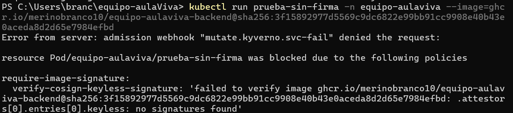 |
| Imagen firmada admitida | 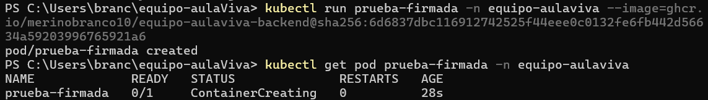 |
| Reporte ZAP | 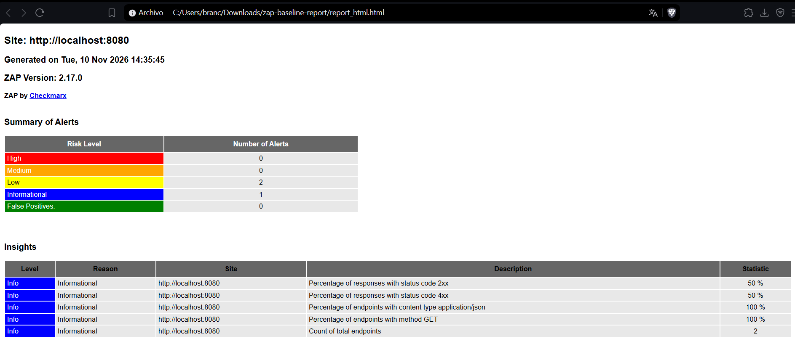 |
| Alerta Falco: shell en contenedor | 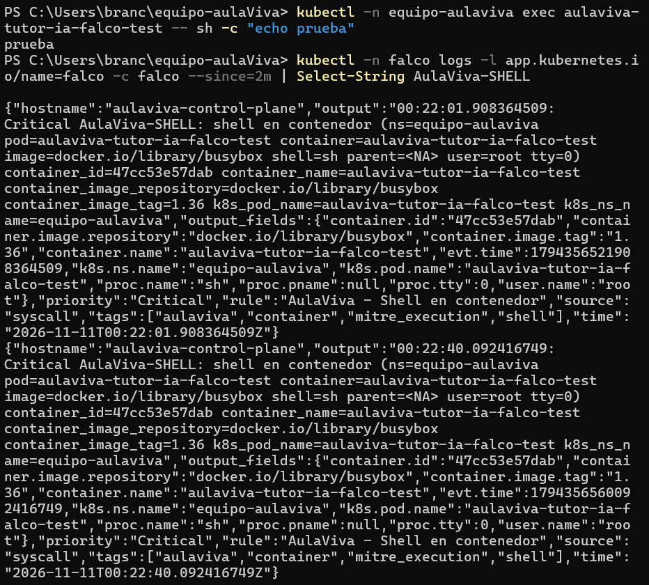 |

## Índice de evidencia para el panel (S18)

> Revisar que las rutas de Resiliencia, y sustituir los marcadores de Actions, staging y el  reporte JaCoCo por URLs reales.

| Criterio | Evidencia |
|---|---|
| Demo | [Guion de demo](docs/demo/guion-demo.md) · **Staging:** `PEGAR_URL_REAL_DE_STAGING` |
| Arquitectura | [C4 L1–L3](docs/c4/) · [Índice de ADRs](docs/adr/README.md) |
| DevSecOps | **Último run de Actions:** `PEGAR_URL_REAL_DEL_RUN` · [Secrets](docs/security/secrets.md) · [Threat model](docs/threat-model.md) |
| IA responsable | [Informe de evaluación](docs/ai/eval-report.md) · [Model card](docs/ai/model-card.md) · [Marco legal](docs/ai/marco-legal.md) |
| Resiliencia | [SLOs](docs/sre/slos.md) · [Plan DR](docs/sre/dr-plan.md) · [Runbooks](docs/runbooks/) · [Post-mortem](docs/postmortems/) |
| FinOps | [Costos](docs/finops/costos.md) · [Mediciones](docs/finops/mediciones.md) |
| Tests | [Trazabilidad](docs/qa/trazabilidad.md) · Reporte JaCoCo: revisar artefacto `jacoco-coverage-report` del último run de CI |

## Lo que no alcanzamos (y por qué)

- **RLS en PostgreSQL:** el aislamiento del MVP se aplica en la capa de aplicación y se valida con pruebas de acceso entre colegios (404). RLS queda como refuerzo en el roadmap.
- **Kafka/MSK:** se mantiene Outbox en tabla en el MVP; Kafka queda diferido hasta que existan al menos dos consumidores que justifiquen el broker.
- **pgvector / embeddings:** el Tutor IA usa recuperación léxica BM25 sobre los apuntes empaquetados en el backend; pgvector corresponde a una evolución futura.
- **Auditoría de fairness amplia:** la evaluación disponible compara dos cursos y 50 casos; es una señal inicial, no una auditoría integral ni representativa de todos los colegios.
- **Fidelidad del Tutor IA:** el resultado global observado fue 88 %, dos puntos porcentuales bajo la meta de 90 %. Se documentan casos fallidos y mejoras pendientes en el informe de evaluación.
- **Persistencia distribuida de caché/presupuesto del tutor:** actualmente viven en memoria y se pierden al reiniciar; no se comparten entre réplicas.
- **Prueba de carga 100×:** se presenta una estrategia de escalamiento, no una capacidad de 100× ya demostrada.

## Roadmap

1. **Identidad federada (Keycloak/OIDC):** cerrar integración y validación de flujos de autenticación/autorización.
2. **RLS en PostgreSQL:** reforzar aislamiento por tenant a nivel de base de datos y agregar pruebas negativas.
3. **Tutor IA con recuperación vectorial (pgvector):** evaluar embeddings frente a BM25 con el golden set y medir calidad, latencia y costo antes de migrar.
4. **Caché y presupuesto compartidos:** mover estado actualmente en memoria a un componente compartido si las réplicas lo requieren.
5. **Calidad de recuperación:** abordar los casos fallidos del `eval-report.md`, especialmente fidelidad y consultas de Ciencias.
6. **Validación de escala:** diseñar y ejecutar pruebas de carga progresivas; no fijar un objetivo 100× sin resultados medidos.

## Defensa — documentos de apoyo

- [Guion de pitch por rol](docs/defensa/guion-pitch.md)
- [Banco de preguntas y respuestas](docs/defensa/banco-qa.md)
- [Deck](https://trello.com/1/cards/6afa6d7775d7b8e1fa90508e/attachments/6b028ffdf5fd41435b19cf81/download/AulaViva_S18_Defensa_Deck.pptx).
