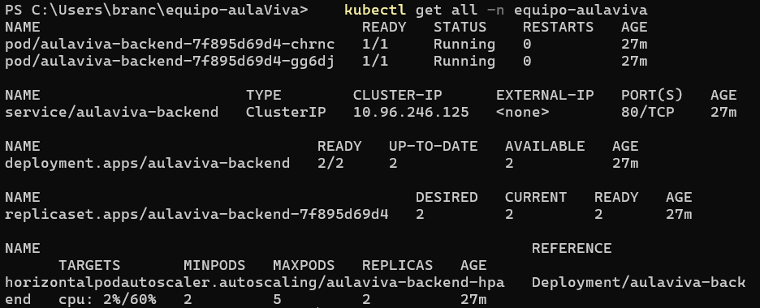
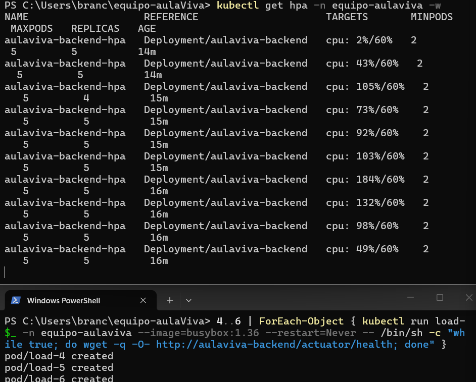
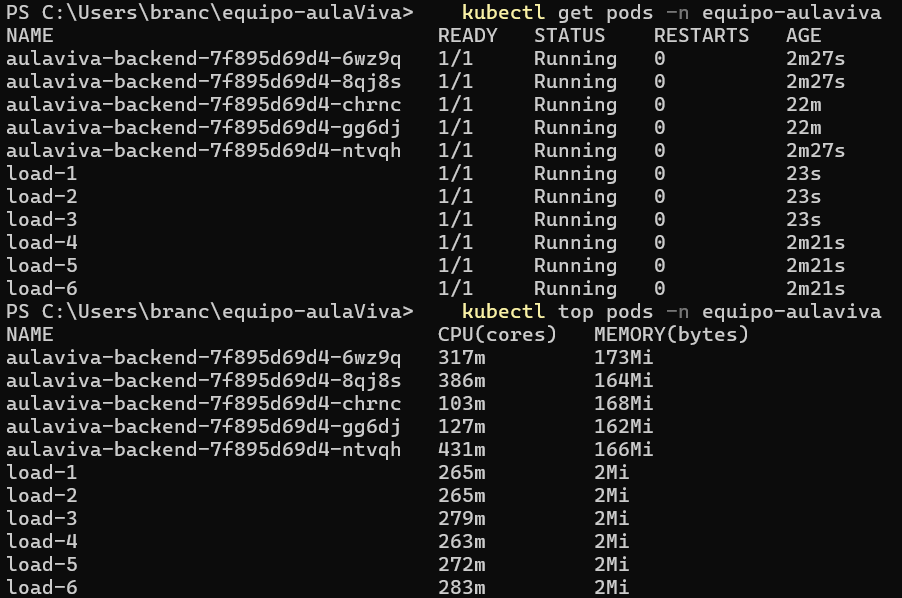
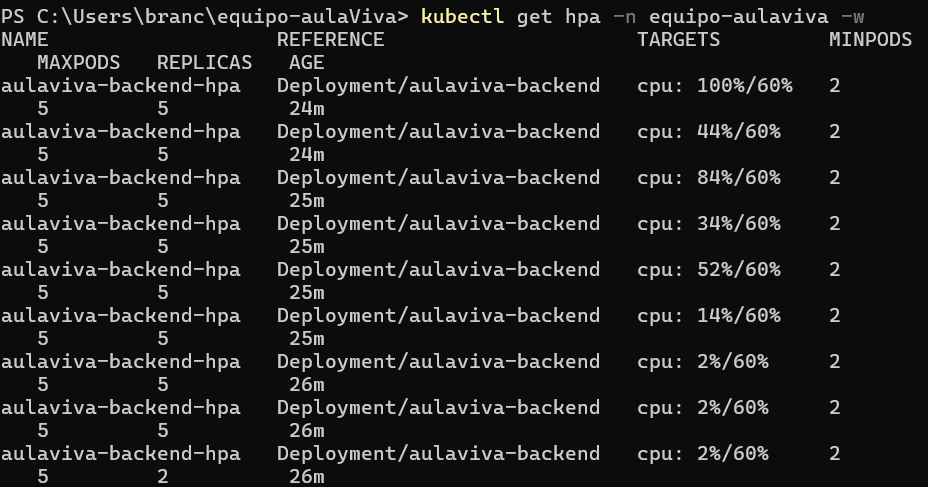
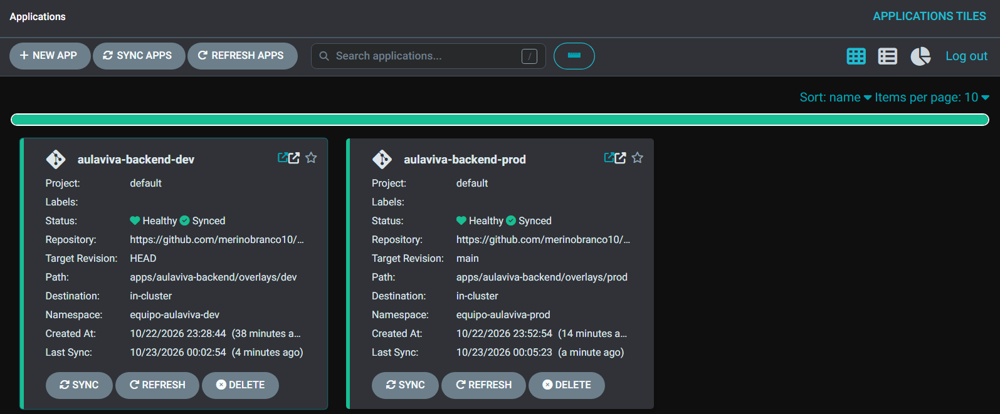
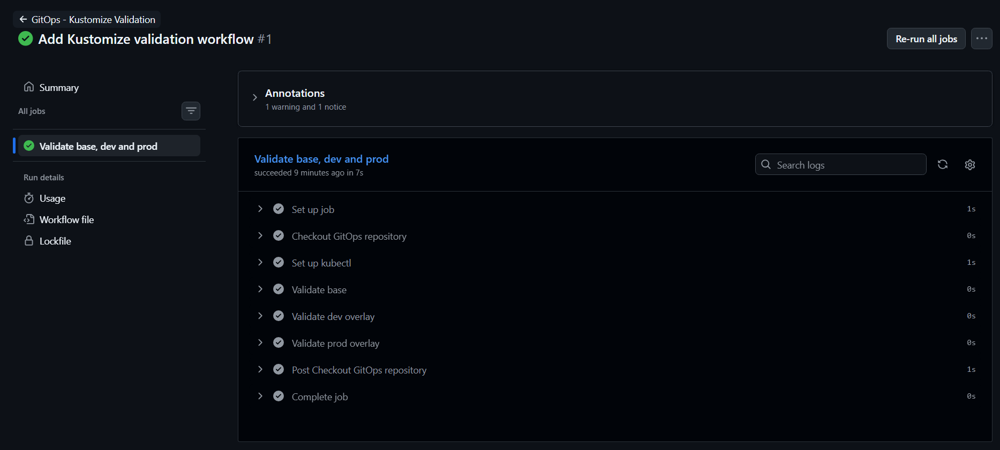
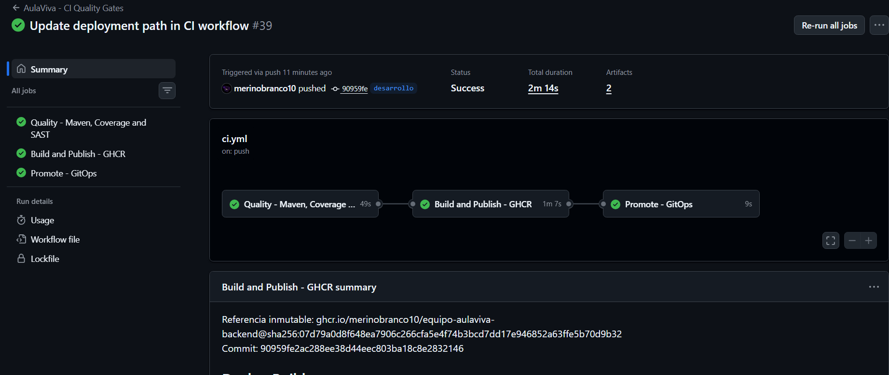

# AulaViva

## Descripción

AulaViva es una plataforma SaaS multi-tenant orientada a colegios de la Región Metropolitana.

El objetivo del proyecto es mejorar la experiencia de aprendizaje de estudiantes y docentes mediante herramientas de gestión académica, evaluaciones y apoyo mediante inteligencia artificial.

## Objetivo del MVP

El MVP de AulaViva contempla:

- Gestión de cursos, docentes y estudiantes.
- Control de acceso basado en roles (RBAC).
- Evaluaciones auto-corregidas con feedback.
- Tutor IA basado en RAG utilizando los apuntes de cada curso.
- Panel para apoderados con seguimiento del avance.

## Equipo

| Integrante | Rol |
|---|---|
| Branco Merino | PO |
| Matías Díaz | Tech Lead |
| Valentina León | DevSecOps |
| Gerardo González | AI/Data |
| Alexander Ruiz-Tagle | QA |

## Organización del proyecto

El trabajo del equipo se gestiona mediante GitHub Issues y un tablero Kanban.

Las columnas del tablero son: Backlog, To Do, In Progress, Review, Blocked y Done.

## Documentación

- [Charter del equipo](CHARTER.md)
- ADRs: `docs/adr/`

## Comunicación

El canal principal de comunicación del equipo es Discord.

Las decisiones importantes del proyecto se documentan en GitHub mediante Issues, Pull Requests o documentos dentro del repositorio.

## Despliegue en Kubernetes (S07)

Servicio principal: `backend/` (Spring Boot 3.5, Java 21).

- **Imagen:** Dockerfile multi-stage (Maven + Temurin 21 para compilar, `distroless/java21-debian12:nonroot` como imagen final), publicada en GHCR y referenciada por digest en `k8s/deployment.yaml`.
- **Manifiestos:** `k8s/` (Deployment, Service, Ingress, ConfigMap y HPA), aplicados con `kubectl apply -k k8s/`.
- **Infraestructura como código:** `terraform/` crea el namespace `equipo-aulaviva` y un secret placeholder. El provider está en `version.tf` y el backend remoto en `backend.tf`.

### Estado del despliegue

### Prueba del HPA

Se realizó una prueba de carga sintética para comprobar el escalado automático del backend. El HPA aumenta las réplicas cuando se supera el umbral de CPU configurado y las reduce cuando termina la carga.

**1. Escalado: la CPU supera el 60% y el HPA sube las réplicas**

**2. Pods y consumo con las réplicas escaladas**

**3. Reducción: al detener la carga vuelve a 2 réplicas**

## CI/CD y GitOps (S08)

Durante S08 se incorporó la validación automatizada del backend y la gestión de los manifiestos Kubernetes mediante un repositorio GitOps independiente.

- **CI:** validaciones automatizadas mediante GitHub Actions.
- **Kustomize:** organización de los manifiestos en una configuración base y overlays para desarrollo y producción.
- **Argo CD:** sincronización automática en desarrollo y sincronización manual en producción.
- **Repositorio GitOps:** [equipo-aulaviva-gitops](https://github.com/merinobranco10/equipo-aulaviva-gitops).

### Evidencias S08

**1. Aplicaciones sincronizadas y saludables en Argo CD**

**2. Validación de manifiestos con Kustomize**

**3. Pipeline de CI exitoso**

## Estado del proyecto

El proyecto cuenta con un backend contenerizado, despliegue en Kubernetes, escalado automático y gestión GitOps mediante Kustomize y Argo CD. Las evidencias documentan las validaciones realizadas en S07 y S08.
