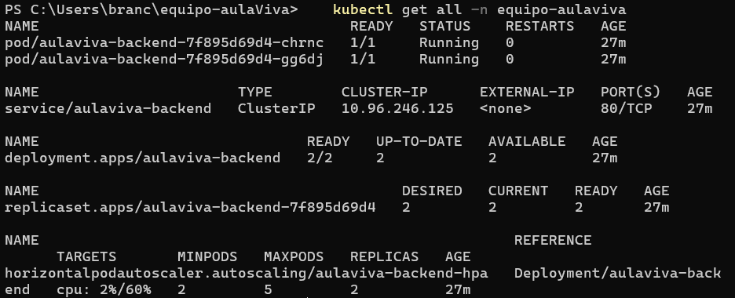
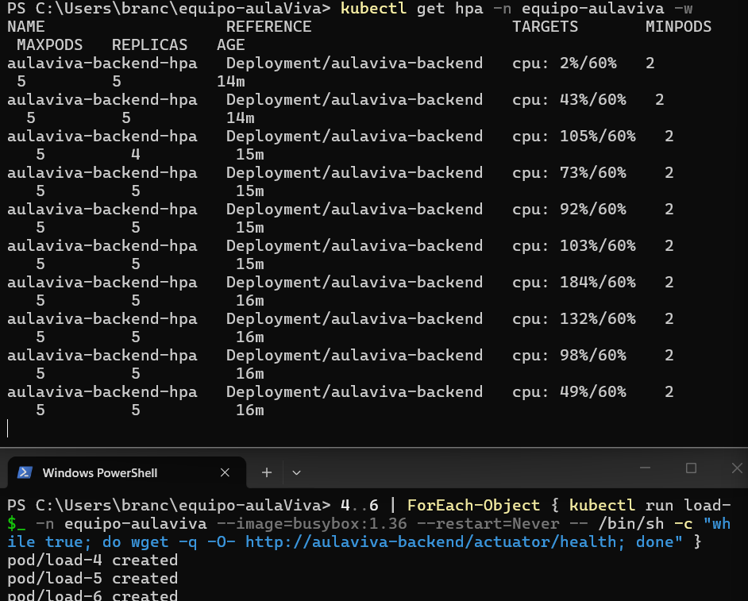
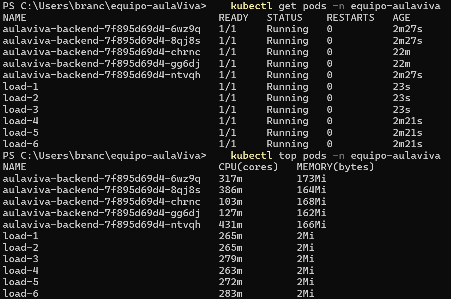
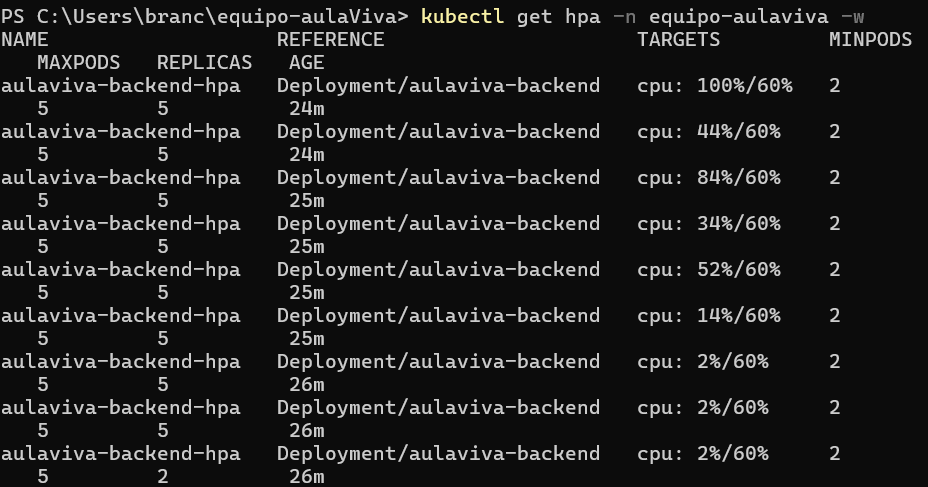
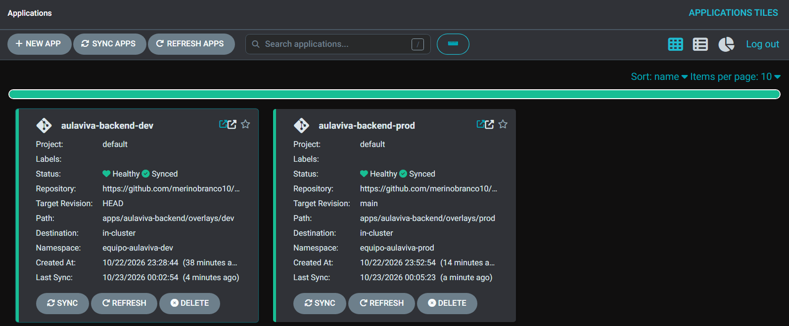
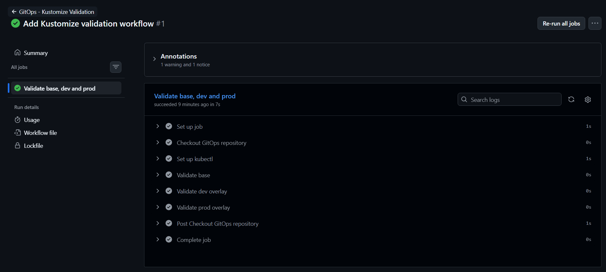
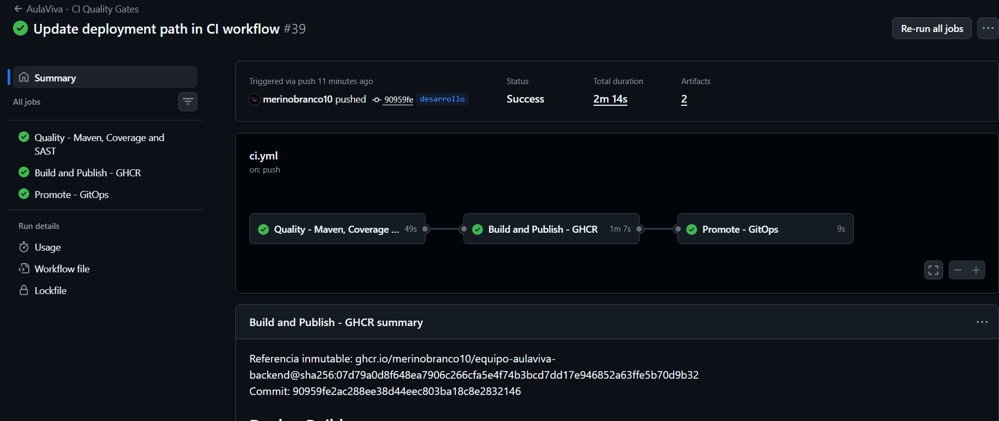

# AulaViva

## Descripción

AulaViva es una plataforma SaaS multi-tenant orientada a colegios de la Región Metropolitana.

El objetivo del proyecto es mejorar la experiencia de aprendizaje de estudiantes y docentes mediante herramientas de gestión académica, evaluaciones y apoyo mediante inteligencia artificial.

## Objetivo del MVP

El MVP de AulaViva contempla:

- Gestión de cursos, docentes y estudiantes.
- Control de acceso basado en roles (RBAC).
- Evaluaciones auto-corregidas con feedback.
- Tutor IA basado en RAG utilizando los apuntes de cada curso.
- Panel para apoderados con seguimiento del avance.

## Equipo

| Integrante | Rol |
|---|---|
| Branco Merino | PO |
| Matías Díaz | Tech Lead |
| Valentina León | DevSecOps |
| Gerardo González | AI/Data |
| Alexander Ruiz-Tagle | QA |

## Organización del proyecto

El trabajo del equipo se gestiona mediante GitHub Issues y un tablero Kanban.

Las columnas del tablero son: Backlog, To Do, In Progress, Review, Blocked y Done.

## Documentación

- [Charter del equipo](CHARTER.md)
- ADRs: `docs/adr/`

## Comunicación

El canal principal de comunicación del equipo es Discord.

Las decisiones importantes del proyecto se documentan en GitHub mediante Issues, Pull Requests o documentos dentro del repositorio.

## Despliegue en Kubernetes (S07)

Servicio principal: `backend/` (Spring Boot 3.5, Java 21).

- **Imagen:** Dockerfile multi-stage (Maven + Temurin 21 para compilar, `distroless/java21-debian12:nonroot` como imagen final), publicada en GHCR y referenciada por digest en `k8s/deployment.yaml`.
- **Manifiestos:** `k8s/` (Deployment, Service, Ingress, ConfigMap y HPA), aplicados con `kubectl apply -k k8s/`.
- **Infraestructura como código:** `terraform/` crea el namespace `equipo-aulaviva` y un secret placeholder. El provider está en `version.tf` y el backend remoto en `backend.tf`.

### Estado del despliegue



### Prueba del HPA

Se realizó una prueba de carga sintética para comprobar el escalado automático del backend. El HPA aumenta las réplicas cuando se supera el umbral de CPU configurado y las reduce cuando termina la carga.

**1. Escalado: la CPU supera el 60% y el HPA sube las réplicas**



**2. Pods y consumo con las réplicas escaladas**



**3. Reducción: al detener la carga vuelve a 2 réplicas**



## CI/CD y GitOps (S08)

Durante S08 se incorporó la validación automatizada del backend y la gestión de los manifiestos Kubernetes mediante un repositorio GitOps independiente.

- **CI:** validaciones automatizadas mediante GitHub Actions.
- **Kustomize:** organización de los manifiestos en una configuración base y overlays para desarrollo y producción.
- **Argo CD:** sincronización automática en desarrollo y sincronización manual en producción.
- **Repositorio GitOps:** [equipo-aulaviva-gitops](https://github.com/merinobranco10/equipo-aulaviva-gitops).

### Evidencias S08

**1. Aplicaciones sincronizadas y saludables en Argo CD**



**2. Validación de manifiestos con Kustomize**



**3. Pipeline de CI exitoso**



## Generación y publicación del SBOM (CycloneDX)

### Objetivo
Generar un inventario de los componentes y dependencias del backend de AulaViva mediante CycloneDX, permitiendo identificar las bibliotecas utilizadas (directas y transitivas) y responder rápido ante un CVE.

### Implementación
Se incorporó el plugin **CycloneDX Maven Plugin** en `backend/pom.xml`, configurado para generar un archivo en formato JSON.

El SBOM se genera en cada ejecución del workflow **AulaViva - Security Analysis** (`.github/workflows/security.yml`), dentro del job `sca`, junto al análisis de dependencias con Trivy.

**Configuración utilizada:**
- Herramienta: CycloneDX Maven Plugin.
- Versión: 2.9.3.
- Formato de salida: JSON.
- Nombre del archivo: `sbom.json`.
- Ubicación de generación: `backend/target/sbom.json`.
- Dependencias de prueba excluidas del inventario.

### Validación
El job `sca` valida con `jq` que el archivo exista, que `bomFormat` sea `CycloneDX`, que tenga `specVersion` y que la lista `components` tenga al menos un elemento. Si la validación falla, el job falla.

### Publicación del artefacto
El archivo se publica como artefacto de GitHub Actions con `actions/upload-artifact@v4`, incluso si Trivy encuentra vulnerabilidades, para poder consultar el inventario durante la remediación.

- **Nombre del artefacto:** `aulaviva-sbom`.
- **Retención:** 90 días (máximo de GitHub Actions). Para conservarlo por más tiempo (auditorías), descargarlo y adjuntarlo a un release.

### Procedimiento para descargar el SBOM
1. Ingresar al repositorio de AulaViva en GitHub.
2. Acceder a la pestaña **Actions**.
3. Seleccionar una ejecución del workflow **AulaViva - Security Analysis**.
4. Ubicar la sección **Artifacts** al final de la ejecución.
5. Descargar el artefacto `aulaviva-sbom`.
6. Descomprimir el archivo y abrir `sbom.json`.

### Consultar el SBOM ante un CVE
```bash
# ¿Está la biblioteca afectada y en qué versión?
jq -r '.components[] | select(.name | test("log4j|spring-boot-starter-actuator")) | "\(.group):\(.name):\(.version)"' sbom.json
```

### Resultado esperado
Un inventario de componentes en formato CycloneDX JSON, que da trazabilidad sobre las dependencias del backend y sirve de insumo para revisiones de seguridad y consultas por CVE.

## Seguridad en el pipeline (S09 · DevSecOps I)

La seguridad se verifica en cada Pull Request hacia `main` y `desarrollo` (y en cada push a `desarrollo`) mediante el workflow **AulaViva - Security Analysis**: `.github/workflows/security.yml`. Los tres jobs corren en paralelo y los tres son **gates bloqueantes**.

| Job | Herramienta | Qué revisa | Cuándo bloquea |
|---|---|---|---|
| `sast` | Semgrep (`p/java`, `p/owasp-top-ten` y reglas propias de `.semgrep/`) | Código Java/Spring Boot del backend | Cualquier hallazgo (`--error`) o fallo de la herramienta |
| `sca` | Trivy (filesystem) + CycloneDX | Dependencias directas y transitivas (`backend/pom.xml`) | Vulnerabilidades HIGH/CRITICAL con parche disponible (`ignore-unfixed`) |
| `secrets` | gitleaks con `fetch-depth: 0` | Archivos actuales e historial completo de Git | Cualquier secreto detectado |

### Artefactos de cada ejecución

| Artefacto | Job | Contenido |
|---|---|---|
| `semgrep-sast-results` | `sast` | Resultados SARIF de Semgrep (14 días) |
| `aulaviva-sbom` | `sca` | `sbom.json` en CycloneDX (90 días) |
| `gitleaks-results.sarif` | `secrets` | Reporte SARIF de gitleaks |

### Reglas propias de Semgrep (`.semgrep/java-security.yml`)

| Regla | Detecta | Referencia |
|---|---|---|
| `aulaviva.spring-cors-wildcard` | `@CrossOrigin` con `origins = "*"` | CWE-942 · OWASP A05:2021 |
| `aulaviva.java-weak-message-digest` | `MessageDigest.getInstance("MD5" \| "SHA-1")` | CWE-328 · OWASP A02:2021 |

Las reglas viven en el repositorio y se versionan junto al código. Para agregar una, crea o edita un archivo en `.semgrep/`; el workflow lo toma automáticamente.

### Cómo re-triar un hallazgo

1. **Abrir el resultado:** en **Actions**, entrar al job que falló. Para SAST, descargar `semgrep-sast-results`; para SCA, revisar la tabla de Trivy en el log; para secretos, el resumen del job.
2. **Priorizar** por explotabilidad (¿se llega desde la red pública?) y criticidad del dato (datos de menores, multi-tenancy), no solo por CVSS.
3. **Decidir** una de estas salidas:
   - **Verdadero positivo:** corregir en el mismo PR (actualizar dependencia, cambiar el código, rotar el secreto).
   - **Falso positivo de SAST:** abrir un PR que corrija la regla en `.semgrep/`. No se aceptan `nosem` ni `nosec` silenciosos.
   - **Falso positivo de secretos:** confirmar con el Tech Lead que el valor es ficticio y agregar el fingerprint exacto a `.gitleaksignore`. Si el secreto era real, **rotarlo** aunque se borre del historial.
   - **Vulnerabilidad que no aplica al contexto:** solicitar una excepción VEX (siguiente sección).
4. **SLA de remediación:** Critical < 7 días · High < 30 días · Medium < 90 días.

### Cómo solicitar una excepción (VEX)

Una excepción declara que una CVE **no es explotable** en AulaViva (por ejemplo, el componente vulnerable no se usa o no es alcanzable). Nunca se usa para ocultar una vulnerabilidad real.

1. Abrir un PR que agregue o actualice `.vex/aulaviva.openvex.json` con la declaración (ejemplo abajo).
2. En la descripción del PR indicar la CVE, la biblioteca, la justificación técnica y quién la revisó (Tech Lead o DevSecOps).
3. Fijar una fecha de revisión; las excepciones se reevalúan en cada release mayor.
4. Una vez aprobada, el equipo DevSecOps configura Trivy para leer el archivo (`TRIVY_VEX` en el paso de Trivy del job `sca`).

```json
{
  "@context": "https://openvex.dev/ns/v0.2.0",
  "@id": "https://github.com/merinobranco10/equipo-aulaviva-desarrollo/vex/1",
  "author": "Equipo AulaViva",
  "timestamp": "2026-11-05T00:00:00Z",
  "version": 1,
  "statements": [
    {
      "vulnerability": { "name": "CVE-XXXX-XXXXX" },
      "products": [
        { "@id": "pkg:maven/cl.aulaviva/aulaviva-backend@0.1.0" }
      ],
      "subcomponents": [
        { "@id": "pkg:maven/GRUPO/ARTEFACTO@VERSION" }
      ],
      "status": "not_affected",
      "justification": "vulnerable_code_not_in_execute_path",
      "impact_statement": "Explicar por qué el código vulnerable no es alcanzable en AulaViva."
    }
  ]
}
```

Si aparecen hallazgos High, el PR debe incluir un plan de remediación o la justificación VEX en su descripción.

### Remediación realizada en el primer run

El primer análisis SCA falló por dos vulnerabilidades HIGH en `spring-boot-starter-actuator` 3.5.6 (CVE-2026-22731 y CVE-2026-22733), ambas con corrección en 3.5.12. Se actualizó Spring Boot a **3.5.12** en `backend/pom.xml` y el siguiente run quedó en verde. 

### Modelo de amenazas

El análisis STRIDE del backend, con tabla de mitigaciones, está en [docs/threat-model.md](docs/threat-model.md).

## Detección de secretos con Gitleaks

### Objetivo

Incorporar un mecanismo automatizado para detectar secretos expuestos en el repositorio AulaViva, incluyendo posibles API Keys, tokens y credenciales, tanto en los archivos actuales como en el historial de Git.

### Implementación

Se integró **Gitleaks** mediante la acción `gitleaks/gitleaks-action@v2` en el workflow `AulaViva - Security Analysis`, ubicado en `.github/workflows/security.yml`.

La configuración incluye:

- Creación de un job independiente denominado `secrets`.
- Uso de `actions/checkout@v4` con `fetch-depth: 0` para obtener el historial completo.
- Ejecución automática de Gitleaks en GitHub Actions.
- Escaneo adicional del historial Git mediante Docker y Gitleaks v8.24.3.
- Uso de `--redact` para evitar mostrar valores sensibles durante el análisis.
- Configuración de códigos de salida bloqueantes para detener el pipeline cuando se detectan secretos.
- Generación y publicación del reporte SARIF como artefacto de GitHub Actions.

### Gestión de hallazgos
### Clasificación final de los hallazgos

Los dos hallazgos detectados en los archivos de ejemplos de API fueron revisados y confirmados por el Tech Lead como valores ficticios utilizados para pruebas.

Por lo tanto, se clasificaron como falsos positivos y se mantuvieron sus fingerprints específicos en `.gitleaksignore`.

No fue necesaria la rotación de credenciales, ya que se confirmó que los valores no corresponden a credenciales reales.

Durante el análisis inicial se identificaron dos coincidencias de la regla `generic-api-key` en archivos de ejemplos de API:

- `api/examples/tutor-question-error.json`
- `api/examples/submit-evaluation.json`

Se incorporaron sus fingerprints específicos al archivo `.gitleaksignore` para excluir esas coincidencias del análisis. Su origen como datos ficticios no ha sido verificado independientemente.

### Validación

En la ejecución de GitHub Actions se verificó:

- Escaneo de 219 commits del historial Git.
- Análisis aproximado de 506 KB.
- Resultado final: `no leaks found`.
- Generación del artefacto `gitleaks-results.sarif.zip`.
- Ejecución exitosa del job de detección de secretos.

### Evidencias

Los resultados pueden consultarse en:

1. Repositorio de AulaViva → pestaña **Actions**.
2. Workflow **AulaViva - Security Analysis**.
3. Job **Secrets - Deteccion de secretos**.
4. Artefactos de la ejecución → `gitleaks-results.sarif.zip`.

### Resultado esperado

Disponer de un control automatizado para identificar posibles secretos expuestos en el código y su historial, evitando que nuevos hallazgos pasen inadvertidos mediante un gate bloqueante en el pipeline de seguridad.

## Estado del proyecto

El proyecto cuenta con un backend contenerizado, despliegue en Kubernetes, escalado automático y gestión GitOps mediante Kustomize y Argo CD. Las evidencias documentan las validaciones realizadas en S07, S08 y S09.
